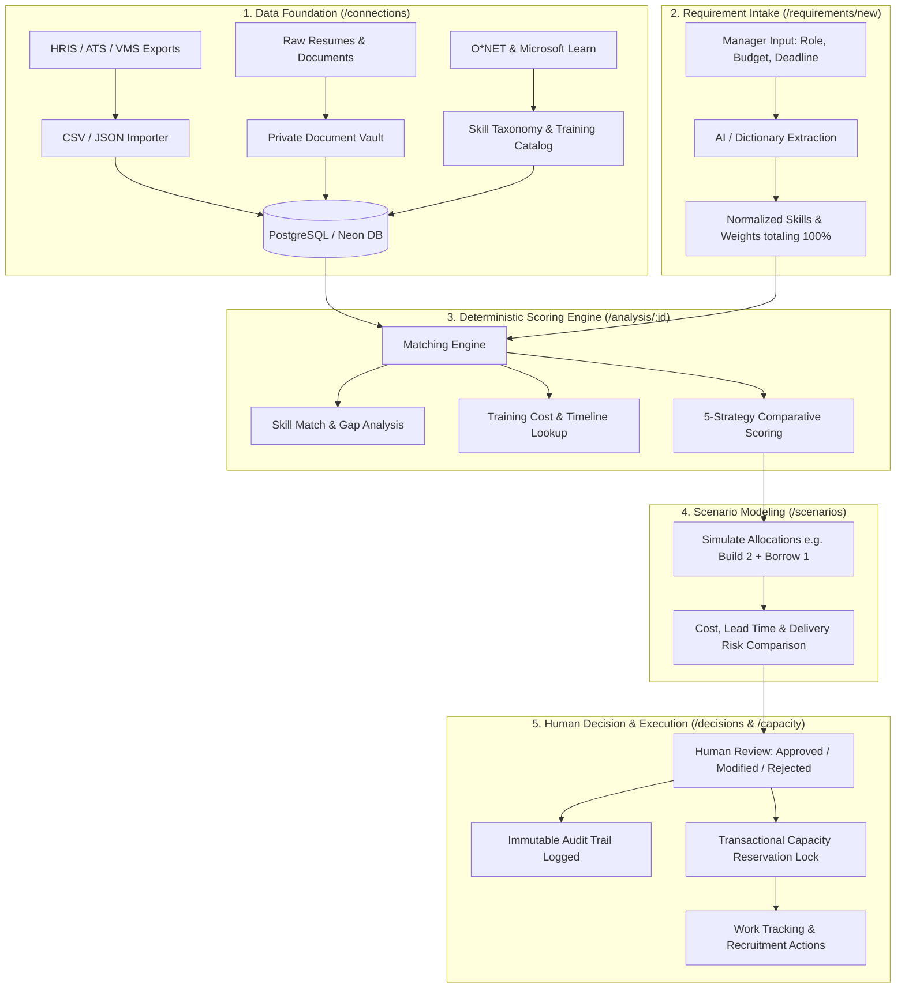

# Workforce Advisory: End-to-End Architecture, Flow & Scoring Guide

## 1. Executive Summary & Core Philosophy

Traditional organizations typically react to hiring requests with a single default action: **"Buy"**—opening an external job requisition and recruiting new personnel.

**Workforce Advisory** is an evidence-led workforce planning and decision-support platform designed to challenge this default. Before opening an external requisition, the platform mathematically models and compares **five alternative delivery strategies**:

| Strategy | Definition | Core Economic & Operational Trade-off |
| :--- | :--- | :--- |
| **BUILD** | Upskill, train, and mobilize existing internal employees | Preserves organizational context, reduces external hiring costs, but incurs training lag. |
| **BUY** | Recruit new permanent full-time employees from the market | Accesses mature external skills, but incurs recruiting fees (8% standard fee) and notice-period delay. |
| **BORROW** | Engage external contractors or specialized contingent talent | Delivers rapid surge capacity with zero long-term commitment, but incurs higher hourly billing rates. |
| **AUTOMATE** | Re-engineer and automate routine/repetitive workflows | Offloads manual hours, reducing net headcount required rather than expanding staff. |
| **RELOCATE** | Shift delivery to lower-cost labor markets or enable remote work | Exploits geographic cost arbitrage and expands the addressable talent pool. |

---

## 2. End-to-End System Flow



---

## 3. Step-by-Step Module Walkthrough

### Phase 1: Data Foundation (`/connections`)
1. **Workforce Records**: Internal employees, external contractors, and candidate pipelines are imported via standard CSV or JSON files.
2. **Document Vault**: Resumes (PDF/TXT) and certifications are stored with SHA-256 integrity checksums.
3. **Reference Taxonomy**: Pre-loaded O\*NET 31.0 occupational standards and official Microsoft Learn modules provide objective benchmarks for skill adjacencies, required learning days, and training costs.

### Phase 2: Requirement Intake (`/requirements/new`)
1. Hiring managers describe requirements using either natural language text or structured fields.
2. The AI module (Gemini) or built-in dictionary normalizes terms into recognized taxonomy skills.
3. The manager defines constraints:
   - **Headcount**, **Location**, and **Target Deadline** (days).
   - **Annual Budget** (INR Lakhs per person per year).
   - **Experience Range** (Minimum and Maximum years).
   - **Mandatory Skills & Weights** (must sum to exactly 100%).
   - **Repetitive Work Percentage** (for automation viability).

### Phase 3: Deterministic Analysis (`/analysis/:id`)
The engine does not rely on opaque AI opinions. It applies mathematical formulas across all candidate profiles to generate side-by-side strategy evaluations.

### Phase 4: Scenario Simulation (`/scenarios`)
Managers test "what-if" models:
- What happens if we Build 2 positions internally and Borrow 1 contractor?
- What happens if we extend the deadline by 15 days to allow internal training?
- What are the budget savings and risk variances?

### Phase 5: Human Decision & Audit Trail (`/decisions`)
- The system enforces human-in-the-loop governance.
- Decisions are recorded as **Approved**, **Modified**, or **Rejected**.
- Justification comments and actor timestamps are written to append-only, immutable database audit tables (`decisions`, `decision_audit`).

### Phase 6: Capacity Reservation & Execution (`/capacity`, `/actions`, `/recruitment`)
- When an internal employee or contractor is approved for a requirement, a transactional database lock (`resource_reservations`) is created.
- This prevents talent from being double-booked by other teams during their reserved window.
- Execution plans (training modules, job requisitions, candidate stages) are tracked through completion.

---

## 4. How Resumes Are Added, Verified, and Scored

### Philosophy: Claims vs. Assessed Evidence
The platform strictly distinguishes between **self-reported claims** and **verified assessments**:
> A resume is an unverified promotional document. AI should never infer quantitative skill proficiencies (0–100) or salary facts directly from raw resume text without human assessment.

### The Resume Pipeline

```
[Candidate / Employee Resume (PDF / TXT)]
                  │
                  ▼
   1. Stored in Private Document Vault (/connections)
      - Saved privately in Neon PostgreSQL
      - Calculated SHA-256 checksum
      - Marked "Awaiting human review; not sent to AI"
                  │
                  ▼
   2. Verification & Assessment Form (/connections or /talent)
      - HR reviewer checks claims against technical interviews / certifications
      - Records assessed skill proficiencies (0–100 scale)
      - Confirms availability timeline, salary / hourly rate, and performance
                  │
                  ▼
   3. Ingested into Talent Records
      - Classified as 'employee', 'contractor', or 'candidate'
      - Associated with source batch and provenance metadata
                  │
                  ▼
   4. Processed by Deterministic Scoring Engine
```

---

## 5. The Scoring Engine & Mathematical Formulas

All scoring algorithms are defined in [`src/lib/engine.ts`](file:///d:/SA/src/lib/engine.ts).

### A. Skill Match Score (0–100)
$$\text{Skill Match} = \sum_{s \in \text{Skills}} \left( \text{Person's Assessed Score}_s \times \frac{\text{Skill Weight}_s}{100} \right)$$

*Example*: If Python is weighted at 40% and PostgreSQL at 60%, a candidate with 90 in Python and 80 in PostgreSQL scores:
$$\text{Skill Match} = (90 \times 0.40) + (80 \times 0.60) = 36 + 48 = 84$$

### B. Skill Gap & Training Calculation
1. Any mandatory skill where the candidate scores **below 65** is classified as a **missing skill**.
2. For each missing skill, the engine retrieves official data from the training catalog:
   - $\text{Training Days} = \sum \text{Catalog Training Days for Missing Skills}$
   - $\text{Training Cost} = \sum \text{Catalog Training Cost for Missing Skills}$
3. **Ready Days** = $\text{Availability (Days)} + \text{Training Days}$.

### C. Experience Fit (0–100)
- If $\text{Experience} \ge \text{Min}$ and $\le \text{Max}$: **100**
- If underqualified: $\text{clamp}(100 - (\text{Min} - \text{Experience}) \times 25)$
- If overqualified: $\text{clamp}(100 - (\text{Experience} - \text{Max}) \times 5)$

### D. Weighted Strategy Fit by Talent Kind

#### 1. Internal Employees (BUILD Strategy)
$$\begin{aligned}
\text{Score} =\; & 0.55 \times \text{Skill Match} \\
& + 0.15 \times \text{Experience Fit} \\
& + 0.10 \times \text{Performance Score} \\
& + 0.10 \times \text{Availability Fit} \\
& + 0.05 \times \text{Learning Agility} \\
& + 0.05 \times \text{Promotion Eligibility (100 if true, 50 if false)}
\end{aligned}$$

#### 2. External Contractors (BORROW Strategy)
$$\begin{aligned}
\text{Score} =\; & 0.50 \times \text{Skill Match} \\
& + 0.20 \times \text{Availability Fit} \\
& + 0.15 \times \text{Historical Performance} \\
& + 0.15 \times \text{Hourly Rate Budget Fit}
\end{aligned}$$

#### 3. ATS Candidates (BUY Strategy)
$$\begin{aligned}
\text{Score} =\; & 0.50 \times \text{Skill Match} \\
& + 0.15 \times \text{Experience Fit} \\
& + 0.15 \times \text{Salary Budget Fit} \\
& + 0.10 \times \text{Location / Remote Fit} \\
& + 0.10 \times \text{Availability Fit}
\end{aligned}$$

### E. Suitability Filter
A person is classified as **Suitable** only when all of the following conditions are met:
1. Not reserved by another active requirement (`!reservedFor`).
2. Skill Match score $\ge 60\%$.
3. $\text{Ready Days} \le \text{Requirement Deadline}$.
4. Experience Fit $\ge 75\%$.
5. Matches primary location or `remoteAllowed` is true.

---

## 6. Summary of Strategy Trade-offs

| Strategy | When It Wins | When It Is Penalized |
| :--- | :--- | :--- |
| **BUILD** | High internal skill overlap, adequate project timeline for training, lower total cost. | Tight deadlines ($< 30$ days), lack of internal talent, or unknown training paths. |
| **BORROW** | Urgent delivery deadlines ($< 21$ days), short project duration ($< 6$ months), high contractor supply. | Long-term projects ($> 12$ months) where continuous hourly contractor billing becomes cost-prohibitive. |
| **BUY** | Long-term permanent initiatives with sufficient lead time ($45+$ days) and open headcount budget. | Short-term surge work or immediate launch dates due to recruiting and notice periods. |
| **AUTOMATE** | Requirements where repetitive/procedural task ratio is high ($> 40\%$). | High-creativity, variable, strategic, or novel technical engineering. |
| **RELOCATE** | Significant geographic salary differentials (e.g. tier-2 cities vs. tier-1 hubs) with remote viability. | Strict on-site co-location constraints. |
